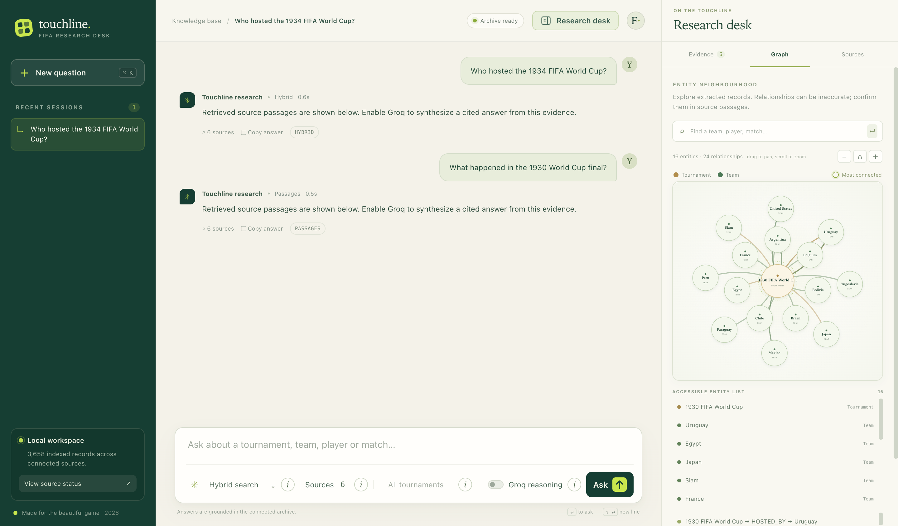
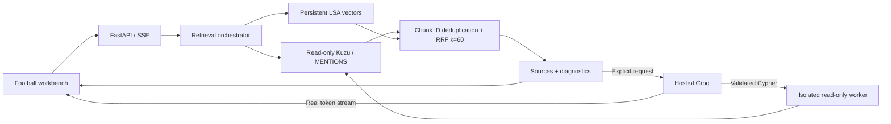

# Touchline — FIFA Hybrid GraphRAG

Touchline is a local-first FIFA World Cup evidence workbench. Ask a question, choose graph, semantic, hybrid, or automatic retrieval, and inspect the source passages and graph context used. It serves a single-page frontend and FastAPI API from one process. Each query retrieves evidence only by default: no hosted inference is called unless you turn on generation for that request. The semantic index uses no model or embedding API.



[Mobile screenshot](docs/screenshots/mobile-chat.png) · [Verification](docs/verification.md) · [Engineering report](docs/engineering-report.md)

## Run locally

Requirements: Python 3.12 and [`uv`](https://docs.astral.sh/uv/). Node.js is optional and is only used for checking frontend JavaScript syntax.

```sh
uv sync
cp .env.example .env
make run
```

Open [http://127.0.0.1:8000](http://127.0.0.1:8000). The launcher is also available directly:

```sh
uv run python -m fifa_rag.startup
```

Paths in `.env` are resolved from the repository root. The graph opens read-only. If it is missing or cannot be opened, the service exposes diagnostics and semantic retrieval can still work when its index is available. Startup does not build data, call an API, or create a replacement graph.

### Optional hosted Groq

Hosted Groq inference is optional. To make it available, set a private key in your local, ignored `.env` file:

```dotenv
GROQ_API_KEY=your_groq_api_key
GROQ_MODEL=openai/gpt-oss-120b
ENABLE_PAID_INFERENCE=true
```

`GROQ_BASE_URL` defaults to `https://api.groq.com/openai/v1`; `groq_api` is accepted as an alternate key name. `ENABLE_PAID_INFERENCE` defaults to true, but each request defaults to `generate=false`, so startup and ordinary evidence queries do not call Groq. Set the flag to false to forbid inference even when a request asks for generation. When you enable the Groq control, retrieved passages are sent to Groq for a cited answer. If graph reasoning is also requested, the service can first ask Groq to plan a graph query and then ask it to synthesize the answer: at most two inference requests per question, with no automatic retry. Generated Cypher is validated and bounded before read-only execution. Evidence retrieval works without credentials or paid inference. For a first integration check, enable the Groq control once in graph, hybrid, or auto mode; this can make one planning request and one synthesis request. See the [Groq model catalog](https://console.groq.com/docs/models) for current model availability and [deprecations](https://console.groq.com/docs/deprecations) before changing `GROQ_MODEL`.

## Retrieval and graph reasoning

The request accepts four modes:

- `graph` looks up passages linked to matching graph entities.
- `semantic` searches a local TF–IDF/LSA index.
- `hybrid` combines both result lists with reciprocal-rank fusion and deduplicates by exact chunk ID.
- `auto` tries graph retrieval and uses semantic retrieval if graph retrieval returns no usable evidence.

Results are evidence passages, not a complete set of records. The API limits a response to 12 passages. Graph entity matching and relationships are extracted records and can be noisy; a missing match is not proof that an event did not occur. Treat aggregate totals and absence claims as unverified unless supported by a complete, independently checked source.

Groq graph planning is an explicit option available only with generation enabled, the service configured for inference, and a non-semantic retrieval mode. The planned query must use the actual schema and return chunk IDs so the service can recover source passages. Invalid or unusable plans fall back to deterministic evidence lookup. Synthesis is grounded in retrieved passages and citation indices are checked, but citation validation does not establish factual entailment. Review every claim against its cited source.

The graph schema and current audited counts are described in [`docs/database-audit.md`](docs/database-audit.md); system boundaries are in [`docs/architecture.md`](docs/architecture.md).

## Build the local semantic index

Semantic search uses TF–IDF followed by truncated singular-value decomposition (latent semantic analysis) and cosine similarity. It does not download neural models, call an embedding service, or require a paid API.

Build or refresh the index explicitly:

```sh
make index
```

This reads existing `Chunk` text and entity links from the configured graph in read-only mode, then writes a versioned snapshot below `data/semantic/`. It atomically switches the local `CURRENT` pointer when the new snapshot is ready. It does not reconstruct source text or modify the graph. Index files are local generated data and are ignored by Git.

You can also build an independent store from trusted JSONL documents without a graph:

```sh
uv run python scripts/build_index.py --documents documents.jsonl --semantic data/semantic
```

Each line requires `id`, `text`, and `source`; optional `metadata` and `entities` preserve provenance. This explicitly replaces the current semantic snapshot, while retaining earlier version directories. Restart the app to load the new snapshot.

## HTTP endpoints

The interactive frontend is served at `/`. API documentation is available at `/docs` while the app is running.

| Method | Path | Purpose |
| --- | --- | --- |
| `GET` | `/api/status` | Graph, semantic index, generation configuration, and supported modes |
| `POST` | `/api/query` | Retrieve source evidence and optionally request Groq planning/synthesis |
| `POST` | `/api/query/stream` | Evidence followed by genuine Groq token events over SSE |
| `GET` | `/api/entities` | Search graph entities |
| `GET` | `/api/graph` | Explore relationships around an entity |
| `POST` | `/api/graph/query` | Run a bounded, read-only `MATCH` query |
| `GET` | `/api/schema` | Inspect graph tables and counts |

A query body can include `question`, `mode`, `top_k` (1–12), `tournament`, `generate`, and `graph_reasoning`. The default is hybrid evidence retrieval without generation.

## Supplemental online sources

See the [verified source research](docs/online-data-sources.md) for downloadable match, award, narrative, and event datasets, observed coverage, licensing, and fetch results. These downloads have not been merged into the active semantic index.

## Data and provenance

The graph’s chunk passages are the source text currently used by Touchline. The raw tournament `.txt` corpus expected by the historical notebook is not included and has not been regenerated. The notebook points to the [FIFA World Cup Wikipedia dataset on Kaggle](https://www.kaggle.com/datasets/ds22f1001123/fifa-world-cup-wikipedia-dataset); an anonymous download attempt returned HTTP 404 during project setup, so the raw source files could not be retrieved there. Existing graph chunks and processed-chunk IDs were supplied as local artifacts.

The audit found 828 chunk records in the selected graph, with evidence links on many relationships. Extraction quality is uneven: the graph has 27 Award nodes but zero `RECEIVED_AWARD` relationships, and only nine `HELD_AT` relationships. These counts describe extracted records, not complete World Cup history. See [`docs/artifact-inventory.md`](docs/artifact-inventory.md) and [`data/original-manifest.json`](data/original-manifest.json) for the root-artifact inventory and SHA-256 baseline. Hash-matched database copies are documented in the inventory and stored under ignored `data/backups/`.

The notebook and filenames identify a Wikipedia-derived corpus distributed through Kaggle. Verify the upstream dataset’s license and attribution requirements before redistributing its text or derivatives. No license has been granted here for unique supplied originals, and this repository does not add an assumed blanket license. Do not treat the absence of a top-level `LICENSE` as a grant of rights.

## Development

Install development dependencies with `uv sync`. Run tests with `make test`; run the lint, frontend syntax, and test checks with `make check`:

```sh
make test
make check
```

See [`CONTRIBUTING.md`](CONTRIBUTING.md) for change and preservation practices. The static frontend has no Node package installation or build step.

## Features and stack

- Four retrieval modes, persistent source metadata, chunk-level deduplication, visible failure diagnostics.
- Optional hosted Groq graph reasoning and genuine streamed answers with clickable source citations.
- Bounded graph neighbourhoods with pan, zoom, node and relationship inspection, search, and a keyboard-accessible entity list.
- Session history in browser local storage, copy actions, loading/error states, and responsive drawers.
- Seeded procedural grass and pitch animation with Retina scaling, reduced motion and offscreen/hidden pause. Fonts use system fallbacks, so there is no required font network request.

Python 3.12, UV, FastAPI, Uvicorn, Kuzu 0.11.3, NumPy/SciPy, scikit-learn, and original HTML/CSS/JavaScript. Node is only needed for `make check`'s JavaScript syntax check; the app needs no frontend package install or build.

## Architecture



The supplied graph has malformed relationship evidence IDs and some native property-projection failures. The graph explorer projects IDs and types without decoding unsafe relationship properties; arbitrary and generated queries execute in a time-limited child process. **No repair or migration has modified the original database.** Source grounding uses intact Chunk text and MENTIONS links. Read the [provenance audit](docs/provenance-audit.md) before using extracted relationships analytically.

## Configuration

| Variable | Default / meaning |
| --- | --- |
| `GRAPH_PATH` | `fifa_production_graphrag_db(2)`; existing file, never auto-created |
| `SEMANTIC_PATH` | `data/semantic`; persistent versioned snapshots |
| `GROQ_API_KEY` / `groq_api` | Optional private hosted inference credential |
| `GROQ_MODEL` | `openai/gpt-oss-120b` |
| `GROQ_BASE_URL` | `https://api.groq.com/openai/v1` |
| `ENABLE_PAID_INFERENCE` | `true`; set `false` to block every provider request |
| `REQUEST_TIMEOUT` | 45 seconds per hosted request |
| `GRAPH_TIMEOUT_MS` | 5,000; worker has an additional shutdown margin |
| `HOST` / `PORT` | `127.0.0.1` / `8000` |

Each query still defaults to `generate=false`. The UI toggle sends an explicit generation request; semantic mode uses at most one call, other reasoning modes at most two. No local neural model is loaded. Restart after configuration changes or an index rebuild.

## Example questions

- Who hosted the 1934 FIFA World Cup?
- What happened in the 1930 World Cup final?
- How did Italy perform in the 1934 World Cup?
- What do the sources say about the 1950 World Cup?

```sh
curl http://127.0.0.1:8000/api/query \
  -H 'Content-Type: application/json' \
  -d '{"question":"Who hosted the 1934 World Cup?","mode":"hybrid","generate":false}'
```

`POST /api/query/stream` accepts the same body and emits SSE `result`, real provider `token` events when enabled, `complete`, and `done`. The first event supplies evidence; the final event checks citations. Streamed partial text is provisional until completion.

## Repository layout

```text
backend/fifa_rag/     configuration, graph access/worker, semantic retrieval,
                     fusion, generation, API and startup
frontend/            original static interface and procedural pitch
scripts/             read-only audits, asset verification, explicit index build
tests/               database integration and offline failure regression tests
docs/                audits, architecture, design, reviews, orchestration
 data/               original hash manifest and graph audit metadata
.github/workflows/   lint, JavaScript syntax and offline test CI
```

Original databases, notebook exports, processed trackers, backups, `.env`, and generated vectors are ignored in Git. Restore the user-supplied production database to `GRAPH_PATH`, retain any companion files, and run `make index`. Do not substitute a fresh empty database. `uv run python scripts/verify_assets.py` checks the 11 supplied originals against their initial hashes; this requires those originals locally. A public checkout has no data blobs: data-backed tests skip when the audited backup is absent, while guard, fusion, semantic-fixture, and provider tests run offline.

## Troubleshooting and limits

| Symptom | Action |
| --- | --- |
| Graph unavailable | Check `GRAPH_PATH`, permissions, Kuzu version and `/api/status`. No reconstruction is attempted. |
| Semantic unavailable | Restore the snapshot or run `make index` explicitly with the supplied graph present. |
| Groq unavailable | Check the key alias, model access, availability flag and source diagnostics; evidence remains usable. |
| No answer | Enable Groq for synthesis, narrow the question, or change retrieval mode. Empty results do not prove absence. |
| Port in use | Set `PORT=8001 make run` (PowerShell: set `$env:PORT` first). |
| Generated graph query fails | Inspect query details/diagnostics. The worker contains native failures and deterministic evidence lookup is retained. |
| Index changed but old results remain | Restart; running processes load the snapshot once. |

The graph is an incomplete and sometimes incorrect extraction, not an authoritative statistics database. LSA has weaker paraphrase understanding than neural embeddings. Auto fallback checks retrieval availability rather than proving that passages fully answer the question. Source citations are range-checked, not automatically checked for entailment. Conversation history is local; prior turns are not sent as conversational context to the model. This is a local single-user service without authentication or public deployment hardening. Full graph repairs require a separately reviewed migration on a copy and explicit approval.

Possible next steps include independently validating extracted facts, repairing provenance on a separate approved copy, stronger hosted semantic embeddings, conversational query rewriting, evaluation against human-reviewed question/answer pairs, and authenticated deployment.

See [verification](docs/verification.md), [engineering report](docs/engineering-report.md), [design references](docs/design-references.md), and [agent execution](docs/orchestration.md). The layout adapts the supplied [analytics chat reference](https://github.com/manyakaistha/nl-analytics-query-engine) and the Type Garden reference from the generative micro-interactions skill through original football visuals; no reference source code was copied. Licensing remains an explicit owner decision before public release.
